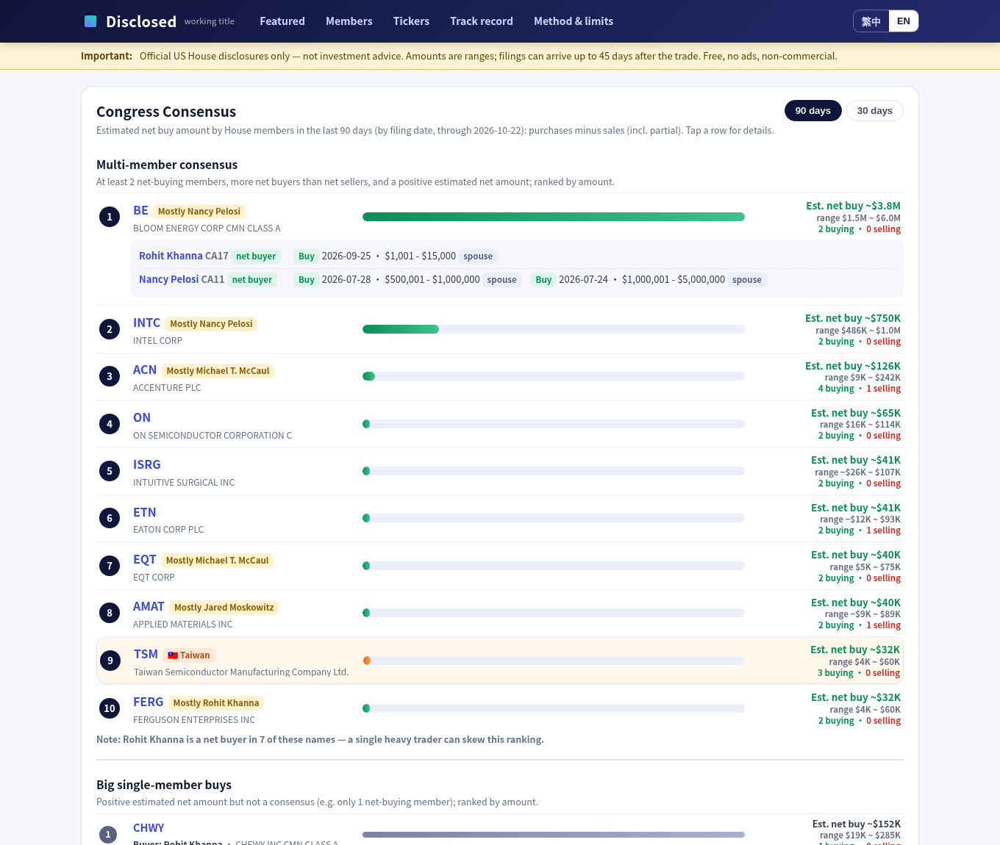
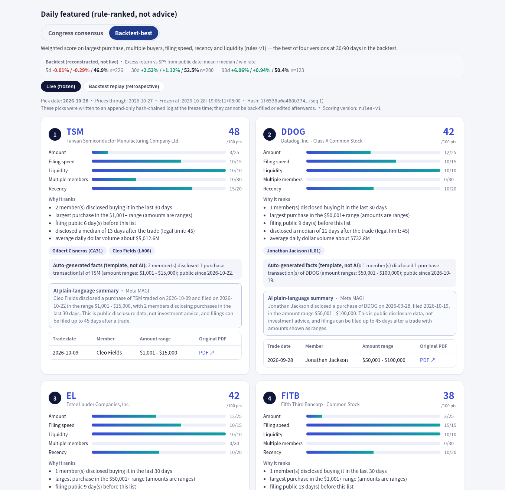
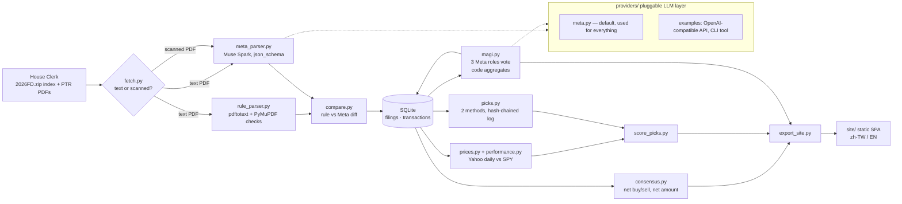

# Disclosed · 披露了

**Live site:** https://jo-peace.github.io/disclosed/ · **Source:** https://github.com/Jo-Peace/disclosed

**U.S. House members' stock trades, read from official PDFs (including scanned paper forms) by Meta's Muse Spark and explained in Traditional Chinese and English.**

> Free · non-commercial · no ads · **not investment advice.** Data comes only from official U.S. House Clerk disclosures. Every row links to its source PDF.

- 🎬 **Demo video:** `[DEMO_VIDEO_URL — add before submission]`
- 🌐 **Live site:** `[LIVE_SITE_URL — add before submission]` (a static build; also runs locally, see [Run it](#run-it))
- 🏁 Built for the **Meta Global AI Developer Hackathon**, Indie Dev track.



---

## The problem

Under the STOCK Act, members of Congress must disclose stock trades within 45 days in *Periodic Transaction Reports* (PTRs). The data is public, but it is hard to use:

- It is spread over **hundreds of PDFs**. In 2026 to date there are **437 House PTRs with 9,136 trades**.
- **53 of those PDFs are scanned paper forms**, with stamps, hand-ticked boxes and no ticker symbols. Ordinary text extraction gets nothing from them.
- Amounts are **ranges** (e.g. "$15,001 – $50,000"), not share counts.
- Nothing serves **Chinese-speaking readers**. We found no Traditional-Chinese tool that explains these filings.

## What Disclosed does

- **Congress Consensus board (議員共識榜).** For each stock it syncs buys *and* sells per member: who is a net buyer and who has already sold. It shows an **estimated net amount** from the disclosed ranges (midpoints; open-ended brackets use the lower bound and are flagged). There are 90- and 30-day views. A separate **Big single-member buys** list flags when one member supplies >60% of the money.
- **Two switchable daily pick methods.**
  - **Congress consensus** (default, `rules-v4-consensus-amount`): ≥2 net buyers, more buyers than sellers, ranked by estimated net amount.
  - **Backtest-best** (`rules-v1`): an additive score over amount, number of buyers, filing speed, recency and liquidity.
  - Tickers picked by both methods on the same day get an **In both / 雙重入選** badge. Use `?m=v1` in the hash to select Backtest-best.
- **Member and ticker pages.** Every filing and trade is listed with a link to the official PDF. Ticker pages chart price vs SPY with filing ticks.
- **Parse-confidence badges on every row.** A badge shows the parse source (rule or Meta vision), the Meta cross-check, the MAGI verdict with its confidence %, an "inferred ticker" flag and an "illegible" flag.
- **Honest track record.**
  - Live picks are **frozen daily into an append-only, SHA-256 hash-chained log**. It cannot be back-dated or edited.
  - Backtests are labelled **reconstructed**.
  - Weak results are shown, not hidden.
- **Bilingual.** The UI defaults to 繁體中文 with a one-click English toggle (`?lang=en`). It is mobile-friendly.



## How Meta models are used

Every AI step uses the **Meta Model API** (`POST https://api.meta.ai/v1/responses`) with **`muse-spark-1.3`**. Outputs are schema-constrained (`text.format = json_schema`). No other AI is used, and there is no silent fallback.

| Job | What Muse Spark does | Result |
|---|---|---|
| **Scanned PDF parsing** | The PDF is sent as `input_file` (`detail: "high"`). The model extracts owner, asset, type, dates, amount range and cap-gains flag for each row. Large filings are chunked. | **53 / 53 scanned filings parsed, 0 failures**: 5,539 rows (5 filings were "nothing to report"). 40 rows were self-flagged as illegible. Paper forms have no tickers, so tickers are inferred by strict name matching and flagged `ticker inferred`. |
| **Independent cross-check of text PDFs** | Meta parses all 384 text PDFs independently of the rule-based parser, and `compare.py` diffs them field by field. | **99.44% full-row agreement (3,577 / 3,597 rows)**; ≥99.67% on every individual field. The disagreements exposed a real rule-parser bug (row-id before owner code), which is now fixed. |
| **MAGI three-role review** | Three separate prompts and schemas: a **data verifier** (is each field right vs the source?), a **risk reviewer** (data and disclosure caveats, *not* market advice) and a **plain-language explainer** (neutral zh-TW + EN). Each votes approve / flag / reject with a confidence. **Plain code, not AI**, aggregates the votes into a verdict and a confidence score. | **1,790 rows in 96 filings reviewed**: 446 approved · 1,307 approved with caveat · 34 needs human review · 3 rejected. Mean confidence 0.818. Coverage: all scanned filings, all rule-vs-Meta disagreements, all rows whose trade date is after the notification date, and 30 random text filings. |
| **Pick summaries** | The explainer role writes short bilingual summaries. Guardrails reject advice and causal claims, and every number must match the data. | 5 / 5 summaries were checked against the pick data. |

Cost control:
- Every request is cached by content hash (`data/llm_cache/`) and logged with token usage (`data/llm_ledger.jsonl`).
- A hard spend cap applies (`DISCLOSED_MAX_SPEND`).
- Full run: 1,028 calls, about $26.75.

## Architecture



## Provider plug-in guide

All LLM calls go through `disclosed/providers/base.py::LLMProvider.generate(system, user, schema, files, …)`.

- **Roles:** `pdf_parser`, `parser`, `risk`, `explainer`.
- **Selection order:** env `DISCLOSED_PROVIDER_<ROLE>` › `providers.toml [roles]` › `meta`.

To add a provider:

1. **An HTTP API** (OpenAI-compatible, Anthropic, Gemini, a local server):
   - Copy `providers/examples/openai_compat.py` and subclass `LLMProvider`.
   - Set `name`, `supports_pdf` and `supports_json_schema`.
   - Implement `available()` (a credentials check, no network) and `generate()`, which returns `LLMResult(text, data, provider, model, usage)`.
   - Raise `MissingCredentials` when the key is absent; callers stop and never fall back.
2. **A CLI tool** (`claude -p`, `gemini -p`, `ollama run`, …): copy `providers/examples/cli_tool.py`. It sends the prompt on stdin and reads the answer from stdout.
3. **Register it** in `providers.toml`:
   ```toml
   [providers.my_other_ai]
   class = "disclosed.providers.examples.openai_compat:OpenAICompatProvider"
   base_url = "http://localhost:11434/v1"
   model = "llama3.1"
   [roles]
   explainer = "my_other_ai"
   ```
   Or override one role at run time: `DISCLOSED_PROVIDER_EXPLAINER=my_other_ai python -m disclosed.magi --doc 20034301`.

The two example providers are **untested stubs**; the submission uses Meta only. A provider without `supports_pdf` can serve the MAGI roles but not `pdf_parser`.

## Results, honestly

Excess return vs SPY measured from the day each filing became public (first trading day after `FilingDate`). Each cell is mean / median / win rate (n). Each (ticker, public date) counts once.

**These are backtests, reconstructed after the fact** using only information public on each date. They are not live results and not a forecast. Samples with n < 10 are not headlined.

| Set | 5 trading days | 30 trading days | 90 trading days |
|---|---|---|---|
| All disclosed purchases (baseline) | −0.01% / −0.14% / 48.2% (2,408) | −0.29% / −1.63% / 44.5% (2,204) | −0.79% / −5.09% / 39.7% (1,632) |
| **Congress consensus** (rules-v4) | +0.78% / +0.03% / 50.3% (165) | +1.27% / **−2.07%** / 43.6% (149) | +4.11% / **−2.13%** / 45.1% (91) |
| **Backtest-best** (rules-v1) | −0.01% / −0.29% / 46.9% (226) | +2.53% / +1.12% / 52.5% (200) | +6.06% / +0.94% / 50.4% (123) |
| **In both** (same-day overlap) | +0.25% / −0.31% / 44.4% (63) | +4.06% / +1.29% / 50.9% (55) | +10.02% / −3.81% / 47.1% (34) |

What we read from this:

- The average disclosed purchase did **not** beat SPY.
- The consensus method's positive means come with **negative medians**: a few big winners, most picks lagging.
- Backtest-best (v1) is the most consistent of the four rule versions we tried. v2 (rank by net-buyer count) and v3 (pure net amount) were tested and dropped.
- The overlap's 90-day mean is driven by a few outliers and n is small.
- Live frozen picks started on 2026-10-28 and have no matured 30/90-day samples yet.
- Rules were chosen *after* seeing backtests, so in-sample bias applies. That is exactly why live picks are frozen from now on.

## Data sources and legal

- **Source:** U.S. House Clerk financial disclosures (`disclosures-clerk.house.gov`): the yearly index plus PTR PDFs, downloaded politely at 1 request per second.
- **Prices:** Yahoo Finance public daily data, cached locally. Missing prices are marked, never imputed.
- **Scope:** the Senate is out of scope. Options, bonds, private funds and preferred shares are excluded from performance.
- **5 U.S.C. § 13107(c):** disclosure data may not be used for any unlawful purpose, any commercial purpose (other than news and communications media), determining credit ratings, or soliciting money. Disclosed is a **free, non-commercial, ad-free research and education project**.
- **Not investment advice.** Amounts are ranges, filings arrive up to 45+ days after the trade, and past results say nothing about the future.

## Run it

Requirements: Python 3.11+ and `poppler-utils` (`pdftotext`). Chrome is optional, for screenshots.

```bash
python3 -m venv .venv && .venv/bin/pip install -r requirements.txt pytest

# Just view the site: site/ ships prebuilt (data.json + prices.json)
.venv/bin/python -m disclosed.serve --port 8000          # → http://127.0.0.1:8000/
.venv/bin/python -m pytest -q                            # 30 tests, no network, no model calls
```

Full pipeline (re-downloads public data). The Meta steps need your own key; copy `.env.example` to `.env`, which is git-ignored.

```bash
.venv/bin/python -m disclosed.fetch all                  # index + PDFs + text/scanned classification (resume-safe)
.venv/bin/python -m disclosed.rule_parser                # text PDFs → rows
.venv/bin/python -m disclosed.meta_parser --kind scanned # Muse Spark (needs MODEL_API_KEY; exits 3 without it)
.venv/bin/python -m disclosed.compare                    # rule vs Meta agreement report
.venv/bin/python -m disclosed.magi --set all             # 3-role review (add --dry-run to print prompts, no key)
.venv/bin/python -m disclosed.prices classify && .venv/bin/python -m disclosed.prices fetch
.venv/bin/python -m disclosed.performance
.venv/bin/python -m disclosed.picks freeze               # freeze today's picks for BOTH methods (append-only)
.venv/bin/python -m disclosed.picks backtest             # reconstructed replays, one file per method
.venv/bin/python -m disclosed.picks verify               # re-check every hash chain
.venv/bin/python -m disclosed.score_picks
.venv/bin/python -m disclosed.export_site                # → site/data.json, site/prices.json
```

`site/` is plain static files with only relative paths, so it can be hosted at a domain root or a subpath (e.g. GitHub Pages `/<repo>/`).

<details><summary>Repository layout</summary>

```
disclosed/       config, db (SQLite), fetch, rule_parser, meta_parser, compare, magi, schema, providers/,
                 tickermap, prices, performance, consensus, names, picks, score_picks, summaries, export_site, serve
site/            static single-page app (index.html, app.js, style.css, data.json, prices.json)
picklog/         live.jsonl (frozen picks, hash chain) + reconstructed backtest_*.jsonl per method
screens/         screenshots (scripts_screens.sh, headless Chrome)
submission/      demo video script and submission text
providers.toml   which AI serves which role (default: Meta for everything)
tests/           unit tests (MAGI aggregation, request shape, return maths, hash chains, net buy/sell, method overlap)
data/            mostly git-ignored (PDFs, SQLite, caches); small reports such as compare_report.txt are kept
```
</details>

## Limitations

- **House only**, 2026 filings only (through 2026-10-22 in this build).
- **Amounts are ranges.** Every "net amount" is an estimate; filings carry no share counts.
- **Tickers on scanned forms are inferred** from company names, and are flagged. Uncertain matches stay unpriced.
- **MAGI covers 1,790 rows, not every row.** Rows not sampled show "MAGI not sampled". Text-PDF rows are rule-parsed and cross-checked by Meta.
- **The parsing self-check is a consistency check** (row counts, field completeness, checkbox count), not a line-by-line human audit.
- **The backtests are in-sample and reconstructed.** Live frozen history is only days old.
- **Filers' own errors are reproduced as printed** (e.g. a trade date after the notification date) and flagged, not "fixed".

## License

MIT for the code (see [LICENSE](LICENSE)). Disclosure data is public U.S. government records, subject to the use restrictions above.
